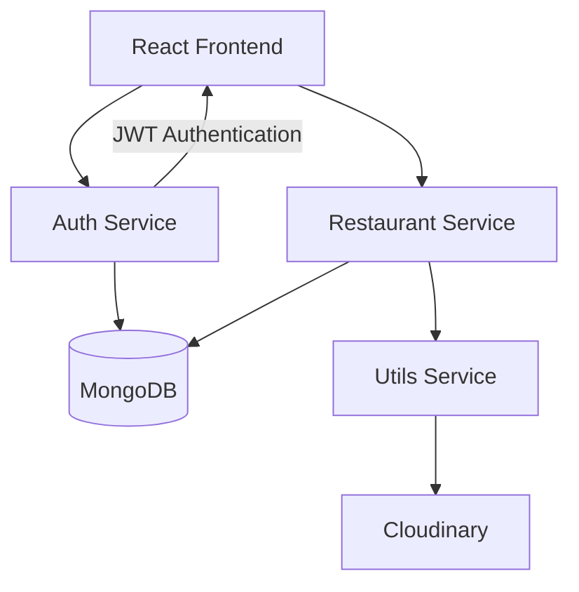
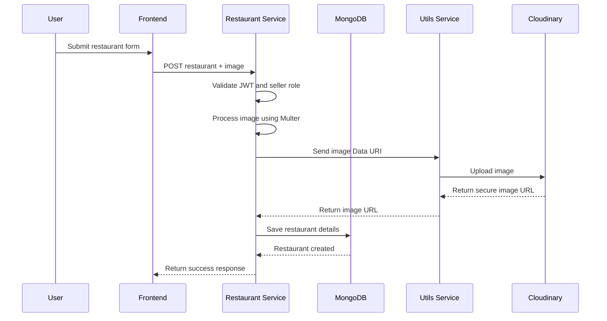

# 🍔 FoodFlow – Food Delivery Platform

FoodFlow is a food delivery platform inspired by applications like Zomato. It follows a **microservices-based architecture**, separating authentication, restaurant management, and utility operations into independent services.

The project focuses on building practical full-stack development skills while understanding backend concepts such as authentication, API communication, file uploads, database operations, and service separation.

## 🚀 Features

- **Google Authentication:** Sign in using Google OAuth.
- **JWT Authentication:** Secure API access using JSON Web Tokens.
- **Role-Based Access Control:** Different access levels for customers and sellers.
- **Restaurant Management:** Sellers can create and manage their restaurant profiles.
- **Image Uploads:** Upload restaurant images using Multer and Cloudinary.
- **Microservices Architecture:** Independent services for authentication, restaurants, and utilities.
- **Protected Routes:** Restrict frontend pages and backend APIs based on authentication and user roles.
- **Geolocation Support:** Store restaurant locations using GeoJSON coordinates.

## 🛠️ Tech Stack

| Category | Technologies |
|---|---|
| Frontend | React, TypeScript, Vite |
| Backend | Node.js, Express.js, TypeScript |
| Database | MongoDB, Mongoose |
| Authentication | Google OAuth, JWT |
| Image Storage | Cloudinary |
| File Handling | Multer |
| API Communication | Axios |

## 🏗️ Architecture

FoodFlow follows a service-oriented architecture where different backend responsibilities are handled by independent services.



### Backend Services

| Service | Port | Responsibility |
|---|---:|---|
| Auth Service | 5000 | Google OAuth, user authentication, JWT and user roles |
| Restaurant Service | 5001 | Restaurant creation, retrieval and management |
| Utils Service | 5002 | Image upload and Cloudinary integration |

**Service communication:**

- The frontend communicates with backend services through HTTP APIs.
- The Auth Service handles user authentication and issues JWTs.
- The Restaurant Service validates authentication and seller permissions before allowing restaurant operations.
- The Utils Service handles image uploads to Cloudinary.
- MongoDB stores user and restaurant information, while Cloudinary stores uploaded images.

## 📂 Project Structure

```text
FoodFlow/
│
├── frontend/
│   └── src/
│       ├── components/
│       ├── pages/
│       ├── context/
│       └── App.tsx
│
└── services/
    ├── auth/
    │   └── src/
    │
    ├── restaurant/
    │   └── src/
    │
    └── utils/
        └── src/
```

*The structure above shows the main application areas; individual service folders contain their respective configurations, routes, controllers, models, and middleware.*

## ⚙️ Getting Started

### 1. Clone the repository

```bash
git clone https://github.com/DevDoshi19/FoodFlow.git

cd FoodFlow
```

### 2. Install dependencies

Install dependencies separately inside the frontend and each backend service:

```bash
cd frontend
npm install

cd ../services/auth
npm install

cd ../restaurant
npm install

cd ../utils
npm install
```

### 3. Configure environment variables

Create `.env` files in the respective application directories.

**Auth Service**

```env
PORT=5000
MONGO_URI=your_mongodb_connection_string
JWT_SECRET=your_jwt_secret
GOOGLE_CLIENT_ID=your_google_client_id
GOOGLE_CLIENT_SECRET=your_google_client_secret
```

**Restaurant Service**

```env
PORT=5001
MONGO_URI=your_mongodb_connection_string
JWT_SECRET=your_jwt_secret
UTILS_SERVICE_URL=http://localhost:5002
```

**Utils Service**

```env
PORT=5002
CLOUD_NAME=your_cloudinary_cloud_name
CLOUD_API_KEY=your_cloudinary_api_key
CLOUD_SECRET_KEY=your_cloudinary_api_secret
```

**Frontend**

```env
VITE_CLIENT_ID=your_google_client_id
VITE_AUTH_SERVICE=http://localhost:5000
VITE_RESTAURANT_SERVICE=http://localhost:5001
```

Never commit real API keys, secrets, or database credentials.

### 4. Run the application

Start each service in a separate terminal:

```bash
# Auth Service
cd services/auth
npm run dev
```

```bash
# Restaurant Service
cd services/restaurant
npm run dev
```

```bash
# Utils Service
cd services/utils
npm run dev
```

```bash
# Frontend
cd frontend
npm run dev
```

The frontend should be available at:

`http://localhost:5173`

*Make sure your MongoDB connection, Google OAuth configuration, and Cloudinary credentials are configured before starting the application.*

## 🔄 Restaurant Creation Workflow

One of the important workflows in FoodFlow is restaurant creation.



## 🎯 Learning Objectives

This project is also a practical learning experience focused on:

- Understanding microservices architecture.
- Implementing authentication and authorization.
- Building REST APIs using Express and TypeScript.
- Managing communication between backend services.
- Handling multipart form data and image uploads.
- Working with MongoDB and Mongoose.
- Structuring frontend applications using React and Context API.
- Debugging real-world issues involving APIs, environment variables, and networking.

## 📌 Project Status

FoodFlow is an ongoing project. New features, improvements, and backend workflows are being developed incrementally.

## 👨‍💻 Author

**Dev Doshi**

B.Tech – Artificial Intelligence & Data Science

- GitHub: [@DevDoshi19](https://github.com/DevDoshi19)

---

*Built to learn, experiment, and understand how real-world full-stack applications work.*