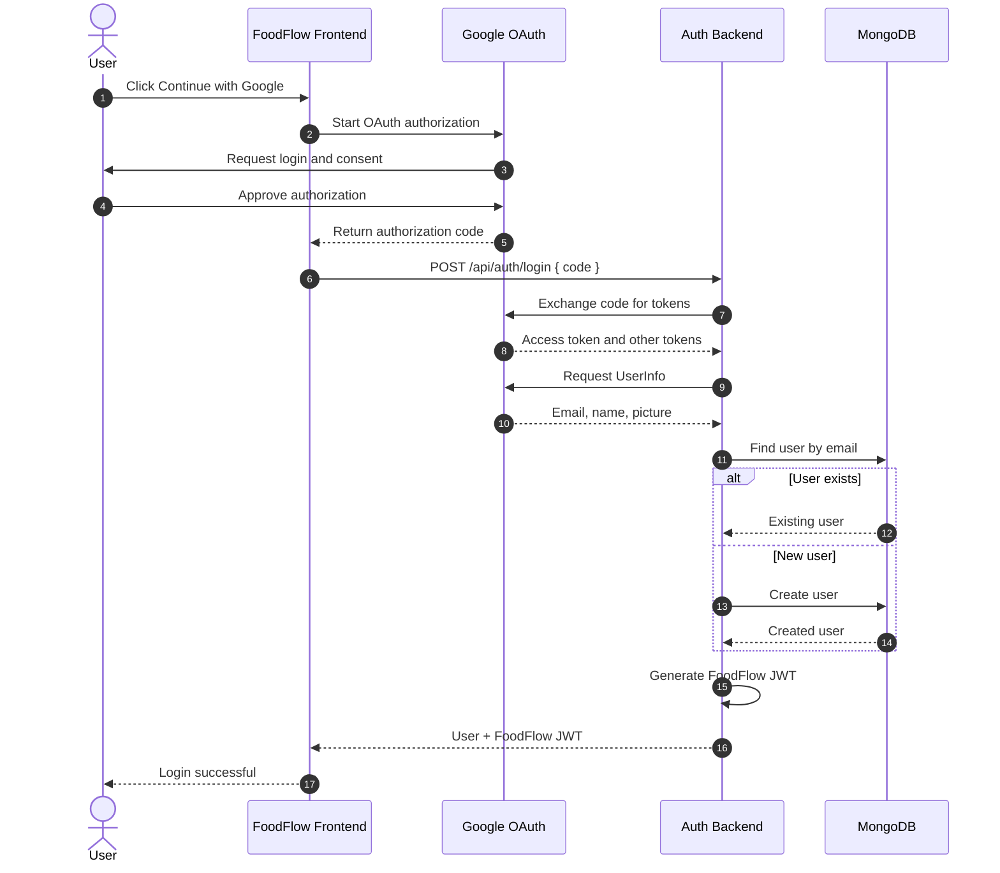
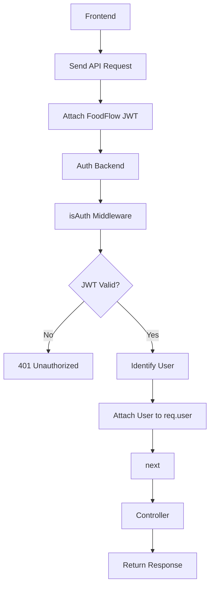
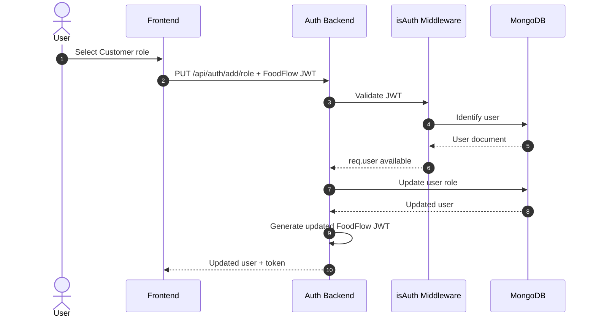
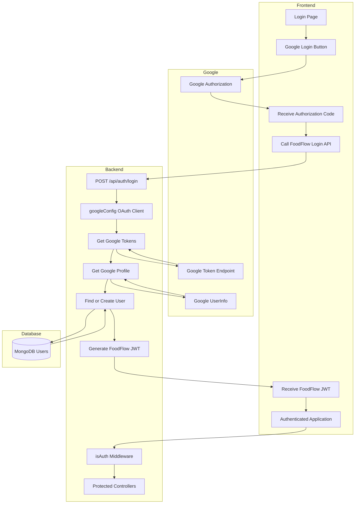

# Google OAuth Integration – Frontend & Backend Flow

> FoodFlow Authentication Service  
> Technology: React, TypeScript, Node.js, Express, Google OAuth 2.0, MongoDB, Mongoose, JWT

## 1. Overview

In the previous authentication implementation, the backend received user information such as email, name, and picture directly from the request body.

Now we are integrating **Google OAuth 2.0**.

Instead of trusting user information sent directly by the frontend, we use Google's authorization flow to verify the user's identity.

The new authentication process:

1. User clicks the Google login button on the frontend.
2. Google handles the user authentication and consent process.
3. Google redirects or returns an authorization code to the frontend.
4. Frontend sends this authorization code to FoodFlow's backend.
5. Backend exchanges the code for Google tokens.
6. Backend retrieves the user's Google profile.
7. Backend finds or creates the user in MongoDB.
8. Backend generates its own FoodFlow JWT.
9. Backend returns the user information and FoodFlow JWT to the frontend.

### Important distinction

There are two different tokens involved:

| Token | Purpose |
|---|---|
| Google access token | Allows the backend to access permitted Google resources |
| FoodFlow JWT | Authenticates the user with FoodFlow APIs |

The Google access token and FoodFlow JWT are not interchangeable.

---

## 2. High-Level Architecture


### Component responsibilities

| Component | Responsibility |
|---|---|
| Frontend | Starts Google login and sends authorization code |
| Google OAuth | Authenticates the user and issues authorization code |
| `googleConfig.ts` | Configures Google OAuth client |
| `auth.ts` | Exchanges code, retrieves profile, manages user login |
| MongoDB | Stores FoodFlow users |
| JWT | Provides authentication for future FoodFlow requests |
| `isAuth` | Protects authenticated routes |

---

## 3. Google OAuth Configuration

File:

```text
services/auth/src/config/googleConfig.ts
```

### Code

```typescript
import { google } from 'googleapis';
import dotenv from 'dotenv';

dotenv.config();

const GOOGLE_CLIENT_ID =
    process.env.GOOGLE_CLIENT_ID as string;

const GOOGLE_CLIENT_SECRET =
    process.env.GOOGLE_CLIENT_SECRET as string;

export const oauth2Client = new google.auth.OAuth2(
    GOOGLE_CLIENT_ID,
    GOOGLE_CLIENT_SECRET
);
```

### Understanding the code

**Google API library**

```typescript
import { google } from 'googleapis';
```

The `googleapis` package provides access to Google's APIs.

We use its OAuth2 client to exchange authorization codes and manage Google OAuth credentials.

**Environment variables**

```typescript
const GOOGLE_CLIENT_ID = process.env.GOOGLE_CLIENT_ID;
const GOOGLE_CLIENT_SECRET = process.env.GOOGLE_CLIENT_SECRET;
```

These values are generated when configuring OAuth credentials in Google Cloud Console.

- Client ID identifies the OAuth application.
- Client Secret authenticates the confidential backend OAuth client.

The client secret must never be exposed to the frontend.

**Creating the OAuth client**

```typescript
export const oauth2Client = new google.auth.OAuth2(
    GOOGLE_CLIENT_ID,
    GOOGLE_CLIENT_SECRET
);
```

This creates a reusable OAuth2 client.

The backend uses this client to exchange authorization codes for tokens.

### Environment variables

Example:

```env
GOOGLE_CLIENT_ID=your_google_client_id
GOOGLE_CLIENT_SECRET=your_google_client_secret
JWT_SECRET=your_foodflow_jwt_secret
```

Never commit actual secrets to GitHub.

---

## 4. Updated Login Controller – Google OAuth

File:

```text
services/auth/src/controllers/auth.ts
```

### Code provided for FoodFlow

```typescript
import { AuthenticatedRequest } from '../middlewares/isAuth.js';
import { oauth2Client } from '../config/googleConfig.js';
import axios from 'axios';

export const loginUser = tryCatch(async (req, res) => {

    // Get authorization code from frontend
    const { code } = req.body;

    if (!code) {
        return res.status(400).json({
            message: "Missing required fields"
        });
    }

    // Exchange authorization code for Google tokens
    const googleRes = await oauth2Client.getToken(code);

    oauth2Client.setCredentials(googleRes.tokens);

    // Retrieve Google user information
    const userRes = await axios.get(
        `https://www.googleapis.com/oauth2/v1/userinfo?alt=json&access_token=${googleRes.tokens.access_token}`
    );

    const { email, name, picture } = userRes.data;

    // Find existing user
    let user = await User.findOne({ email });

    // Create user if not found
    if (!user) {
        user = await User.create({
            email,
            name,
            image: picture
        });
    }

    // Generate FoodFlow JWT
    const token = jwt.sign(
        { user },
        process.env.JWT_SECRET as string,
        {
            expiresIn: '15d'
        }
    );

    res.status(200).json({
        message: "User logged in successfully",
        user,
        token
    });
});
```

*Note: This is the supplied implementation, shown for understanding. The production recommendations in Section 11 explain important improvements.*

---

## 5. Understanding the Google Login Controller

### Step 1: Receive authorization code

```typescript
const { code } = req.body;
```

The frontend sends an authorization code to the backend.

Example request:

```json
{
    "code": "4/0Axxxxxxxxxxxxxxxx"
}
```

This is not the Google access token.

It is a temporary authorization code that the backend exchanges with Google.

### Step 2: Validate the code

```typescript
if (!code) {
    return res.status(400).json({
        message: "Missing required fields"
    });
}
```

If the frontend doesn't send the code, the backend cannot continue.

We return HTTP 400 Bad Request.

### Step 3: Exchange authorization code for Google tokens

```typescript
const googleRes = await oauth2Client.getToken(code);
```

This is an important step.

The backend sends the authorization code to Google's OAuth token endpoint.

Google returns token information, typically including:

- Access token
- Token type
- Expiration information
- Refresh token, when issued
- ID token, when requested by the OAuth flow

Conceptually:

```text
Authorization Code
       |
       v
Google OAuth Token Endpoint
       |
       v
Google Tokens
```

The authorization code can only be exchanged under the appropriate OAuth client, redirect URI, and flow configuration.

### Step 4: Set OAuth credentials

```typescript
oauth2Client.setCredentials(googleRes.tokens);
```

This attaches the returned Google credentials to the OAuth client.

The configured client can now make authorized Google API requests.

### Step 5: Retrieve Google user information

```typescript
const userRes = await axios.get(
    `https://www.googleapis.com/oauth2/v1/userinfo?alt=json&access_token=${googleRes.tokens.access_token}`
);
```

We call Google's UserInfo endpoint to retrieve the user's profile.

The response may contain:

```json
{
    "id": "123456789",
    "email": "user@gmail.com",
    "verified_email": true,
    "name": "Example User",
    "picture": "https://example.com/profile.jpg"
}
```

The exact returned fields depend on the permissions and account.

### Step 6: Extract profile information

```typescript
const { email, name, picture } = userRes.data;
```

We extract the details needed to create or identify a FoodFlow user.

### Step 7: Find or create the user

```typescript
let user = await User.findOne({ email });
```

If a user with this email already exists, we reuse the existing account.

Otherwise:

```typescript
user = await User.create({
    email,
    name,
    image: picture
});
```

This is often called **find-or-create login logic**.

### Step 8: Generate FoodFlow JWT

```typescript
const token = jwt.sign(
    { user },
    process.env.JWT_SECRET as string,
    { expiresIn: '15d' }
);
```

After Google verifies the user's identity, FoodFlow generates its own authentication token.

This token is used for subsequent FoodFlow API requests.

### Step 9: Return the response

```typescript
res.status(200).json({
    message: "User logged in successfully",
    user,
    token
});
```

Frontend receives the authenticated user's information and FoodFlow JWT.

---

## 6. End-to-End Sequence Diagram

This diagram shows which system communicates with which other system.



---

## 7. Frontend and Backend API Contract

The frontend and backend communicate through HTTP.

### Login endpoint

```http
POST /api/auth/login
```

Request body:

```json
{
    "code": "GOOGLE_AUTHORIZATION_CODE"
}
```

Successful response:

```json
{
    "message": "User logged in successfully",
    "user": {
        "_id": "671abc123",
        "name": "Example User",
        "email": "user@gmail.com",
        "image": "https://example.com/profile.jpg",
        "role": null
    },
    "token": "FOODFLOW_JWT"
}
```

The response is illustrative.

### Important

The frontend should send the authorization code, not a user object containing an arbitrary email or profile information.

The backend must independently verify the Google identity before creating or authenticating a FoodFlow account.

---

## 8. Protected Routes After Google Login

Google OAuth is only the login process.

Once login succeeds, FoodFlow uses its own JWT for protected routes.

For example:

```typescript
router.post('/login', loginUser);

router.put('/add/role', isAuth, addUserRole);

router.get('/profile', isAuth, myProfile);
```

### Request to protected endpoint

```http
GET /api/auth/profile
Authorization: Bearer FOODFLOW_JWT
```

### Protected request diagram



### Understanding the separation

| Stage | Responsibility |
|---|---|
| Google OAuth | Proves the user's Google identity |
| FoodFlow JWT | Authenticates the user with FoodFlow |
| `isAuth` | Validates FoodFlow JWT |
| Controller | Executes the requested operation |

The frontend does not need to repeat Google OAuth for every protected API request.

---

## 9. User Role Selection Flow

After successful Google login, a new FoodFlow user may not have a role.

For example:

```json
{
    "name": "Example User",
    "email": "user@gmail.com",
    "role": null
}
```

The frontend can ask the user to select a role:

- Customer
- Rider
- Seller

The frontend then calls:

```http
PUT /api/auth/add/role
Authorization: Bearer FOODFLOW_JWT
```

Request:

```json
{
    "role": "customer"
}
```

Backend flow:



The backend should validate the role against an allowed list. Never trust a role value solely because the frontend supplied it.

---

## 10. Complete Authentication Architecture



---

## 11. Production-Level Security Improvements

The supplied code demonstrates the integration, but a production implementation should improve several things.

### 11.1 Validate environment variables

Instead of assuming the secret exists:

```typescript
process.env.JWT_SECRET as string
```

Validate it when the application starts.

TypeScript's `as string` does not check the actual environment variable at runtime.

### 11.2 Validate the Google identity

Do not assume that receiving a profile response automatically means every account should be accepted.

At minimum:

- Require an email.
- Require a verified email where applicable.
- Validate the Google account identity.
- Handle missing profile fields.
- Consider storing Google's unique account ID (`sub`) as the provider identifier.

The Google account's unique subject identifier is safer for identifying the provider account than relying only on email.

### 11.3 Prefer a verified identity flow

For production authentication, consider validating Google's ID token or using a supported Google OAuth/OpenID Connect library.

Validate:

- Signature
- Issuer
- Audience
- Expiration
- Nonce, when applicable

Do not simply decode an ID token and trust its contents.

### 11.4 Avoid putting the full user document in JWT

Current approach:

```typescript
jwt.sign({ user }, secret, {
    expiresIn: '15d'
});
```

Prefer:

```typescript
jwt.sign(
    { userId: user._id.toString() },
    secret,
    { expiresIn: '15d' }
);
```

The authentication middleware can then retrieve the current user from MongoDB.

### 11.5 Avoid leaking access tokens

Do not include Google access tokens in frontend responses.

The frontend normally only needs the FoodFlow authentication result.

Keep Google credentials on the backend and request only the Google scopes needed for the application.

### 11.6 Handle token and network failures

Consider:

- Invalid or reused authorization code.
- Expired authorization code.
- Incorrect redirect URI.
- Google API unavailable.
- Missing email.
- MongoDB connection failure.
- Duplicate user creation.
- Invalid FoodFlow JWT.

### 11.7 Use secure token storage

Choose a secure session strategy for the frontend.

For browser applications, an HTTP-only, Secure, appropriately configured SameSite cookie is often preferable to storing a long-lived authentication token in localStorage.

If using cookies for authentication, implement appropriate CSRF protections.

### 11.8 Prevent duplicate account races

Two login requests for the same new email may arrive at almost the same time.

Use a database unique index and handle duplicate-key errors. Consider an atomic upsert where appropriate.

---

## 12. Important OAuth Concepts

| Concept | Explanation |
|---|---|
| OAuth 2.0 | Authorization framework |
| OpenID Connect | Identity layer built on OAuth 2.0 |
| Client ID | Public identifier of the OAuth application |
| Client Secret | Confidential credential used by backend OAuth client |
| Authorization Code | Temporary code exchanged for tokens |
| Access Token | Credential used to access permitted resources |
| ID Token | Signed identity token containing user claims |
| Refresh Token | Credential used to obtain new access tokens, when issued |
| Scope | Permissions requested from Google |
| Redirect URI | Registered location to which Google returns the authorization response |
| State | Value used to protect the OAuth flow against CSRF |
| Nonce | Value used to bind an ID token to an authentication request |

### OAuth flow to remember

```text
Authorization Request
        |
        v
User Authentication
        |
        v
Authorization Code
        |
        v
Token Exchange
        |
        v
Access Token / ID Token
        |
        v
Verify Identity
        |
        v
FoodFlow JWT
```

---

## 13. Troubleshooting Checklist

| Problem | Things to verify |
|---|---|
| `redirect_uri_mismatch` | Frontend redirect URI and Google Cloud configuration |
| `invalid_grant` | Code expiration, code reuse, redirect URI and OAuth client |
| `invalid_client` | Client ID and Client Secret |
| `access_denied` | User denied authorization |
| UserInfo returns 401 | Access token validity and scopes |
| Backend receives no code | Frontend callback handling and request body |
| CORS error | Backend CORS origin configuration |
| JWT verification fails | Correct JWT secret, expiry and token format |
| Google login works but profile fails | UserInfo request and granted scopes |

---

## 14. Learning Summary

What we have implemented:

1. Configured the Google OAuth client.
2. Created a backend login endpoint that accepts an authorization code.
3. Exchanged the code for Google tokens.
4. Retrieved the Google user profile.
5. Found or created the corresponding FoodFlow user.
6. Generated a FoodFlow JWT.
7. Returned the authenticated user and JWT to the frontend.

What the frontend will now implement:

1. Google login button.
2. Google OAuth authorization flow.
3. Authorization code handling.
4. API request to FoodFlow `/api/auth/login`.
5. Handling the backend response.
6. Authenticated application state.
7. Protected API requests using the FoodFlow authentication mechanism.
8. Role selection for new users.

### Final Mental Model

**Google authenticates the person. FoodFlow creates or identifies the application user. FoodFlow issues its own JWT. That JWT is used to access protected FoodFlow APIs.**

This separation is the key to understanding third-party authentication integration in a backend application.
